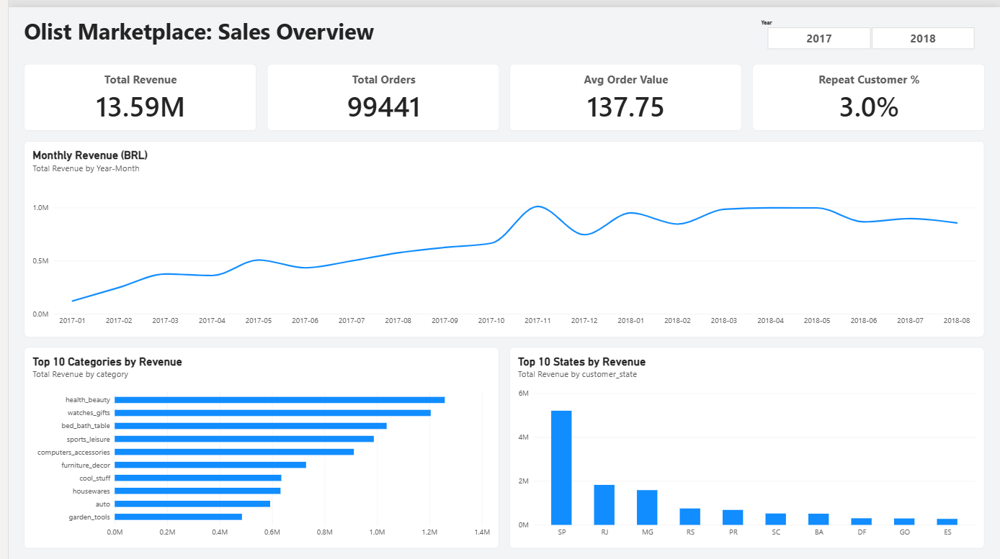
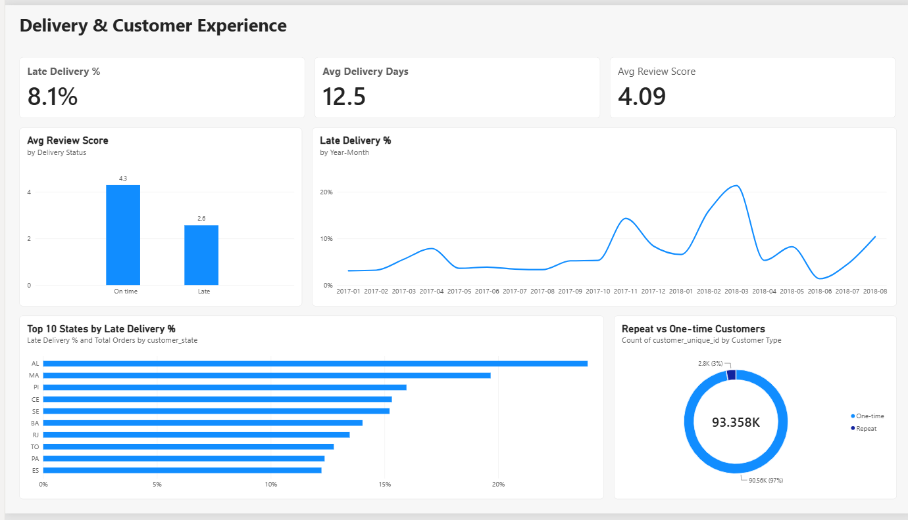

# Olist Marketplace Analytics

End-to-end analytics project on ~100k e-commerce orders: **Excel → Python → MySQL → Power BI**.
I analyzed where revenue comes from, how delivery delays affect customer reviews, and how many customers come back.

## Dashboard




## Business questions

1. How do revenue, orders and average order value trend by month?
2. Which product categories and states earn the most?
3. How often are deliveries late, and does it lower review scores?
4. What share of customers buy again?

## Key findings

- **Revenue grew about 8x in 2017**, from roughly R$0.12M in January to about R$1.0M in November (Black Friday peak). Total item revenue: **R$13.59M** across **99,441 orders**.
- **Revenue is concentrated geographically.** São Paulo alone brings in R$5.2M (about 38%), and SP, RJ and MG together make up about 63%.
- **Top categories:** health_beauty, watches_gifts and bed_bath_table lead, each above R$1.0M.
- **Late deliveries cost customer satisfaction.** About **8.1%** of delivered orders arrived after the promised date. On-time orders average **4.29 stars** against **2.57 stars** for late ones, a drop of about 1.7 stars.
- **Retention is very low.** Only **3.0%** of customers (2,801 of 93,358) ordered more than once.
- **Late delivery rates vary by state and month**, with states such as AL, MA and PI at the top and a peak around March 2018.

## Recommendations

1. Improve delivery-time estimates and carrier performance in the states with the highest late rates, since late orders lose about 1.7 review stars.
2. Invest in retention (follow-up offers, loyalty rewards), because 97% of customers never return.
3. Plan logistics capacity ahead of peak periods such as Black Friday.

## Workflow

| Tool | What I used it for |
|---|---|
| **Excel** | Data dictionary, profiling, pivot tables (orders by status and month), and a reconciliation sheet comparing totals across tools |
| **Python (pandas)** | Cleaning, delivery-delay features, review de-duplication, category and state analysis, repeat-customer analysis, loading tables into MySQL |
| **MySQL** | Schema and indexes, validation checks, analysis queries (CTEs, window functions), reporting views |
| **Power BI** | Star schema, date table, DAX measures, 2-page interactive dashboard |

## Data quality checks and decisions

- No duplicate orders. 551 orders had more than one review, so I kept the **latest review per order** (99,224 → 98,673 rows) to avoid double counting.
- 2,965 orders have no delivery date (shipped, canceled, unavailable and so on). 8 orders marked "delivered" also have no delivery date. Delivery analysis uses only delivered orders with a delivery date (**96,470**).
- `customer_id` changes with every order, so repeat customers are counted with `customer_unique_id`.
- Trend charts cover **Jan 2017 to Aug 2018**. Months outside this range have very little data.
- **Reconciliation:** total item price of **R$13,591,643.70** matches across Excel, Python, MySQL and Power BI.

## Data model

Star schema in Power BI. A `Dim_Date` table (marked as the date table) links one-to-many to `Orders` and `Sales_Items`. `Customers` is a standalone customer-level table used for the repeat-rate measure.

Power BI reads three SQL views: `vw_orders` (one row per order), `vw_sales_items` (one row per item) and `vw_customers` (one row per customer).

Main DAX measures: Total Revenue, Total Orders, Avg Order Value, Late Delivery %, Avg Review Score, Repeat Customer %, Revenue MoM %.

## Repository structure

```
olist-marketplace-analytics/
├── excel/        olist_profiling.xlsx (data dictionary, pivots, reconciliation)
├── python/       01_load_check, 02_cleaning, 03_analysis, 04_load_to_mysql (notebooks)
├── sql/          00_create_database, 01_indexes_and_validation, 02_analysis, 03_views
├── powerbi/      olist_dashboard.pbix
├── screenshots/  dashboard images
└── README.md
```

## How to reproduce

1. Download the [Olist dataset from Kaggle](https://www.kaggle.com/datasets/olistbr/brazilian-ecommerce) and place the CSVs in `data/raw/` (not included in this repo).
2. Run `sql/00_create_database.sql` in MySQL.
3. Run `python/04_load_to_mysql.ipynb` (it asks for your MySQL password at run time).
4. Run `sql/01_indexes_and_validation.sql`, then `sql/03_views.sql`.
5. Open `powerbi/olist_dashboard.pbix` and refresh the data.

## Limitations

- Revenue means item price only, before freight, and includes all order statuses.
- The dataset is historical (Sept 2016 to Oct 2018), so findings describe that period.
- The late-delivery vs review link is an association, not proof of cause.
- The geolocation table was not used, since none of the four questions needed it.

## Applying this to Indian e-commerce

The same workflow carries over directly to Flipkart-, Meesho- or Swiggy-style data. I would add cash-on-delivery vs prepaid orders, delivery time in tier-1 vs tier-2 cities, and festive-season spikes (Diwali) in place of Black Friday.

## Tools

Excel · Python (pandas, SQLAlchemy, matplotlib) · MySQL · Power BI · Git/GitHub